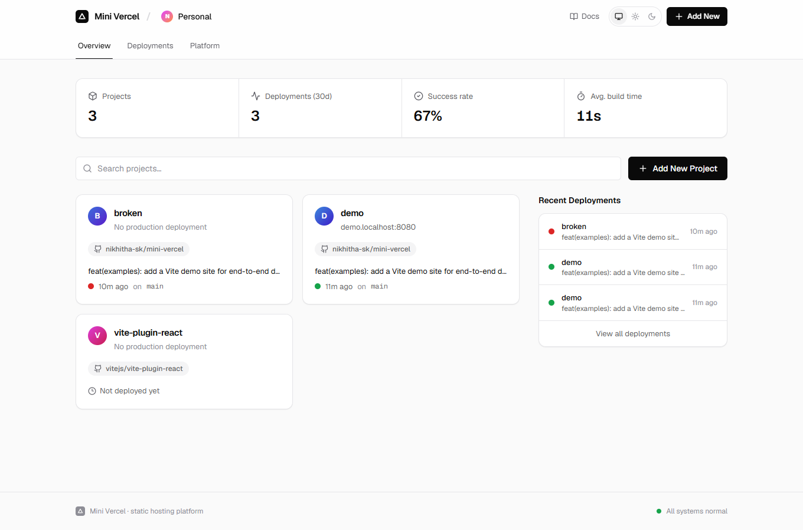
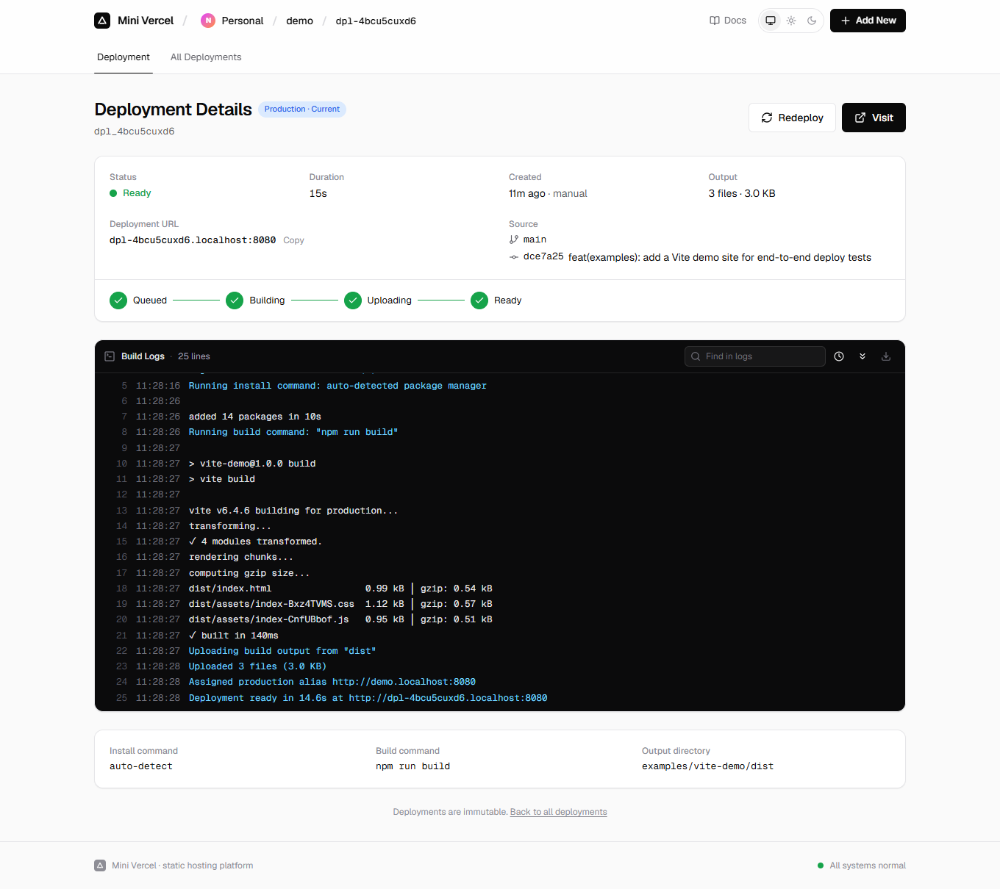
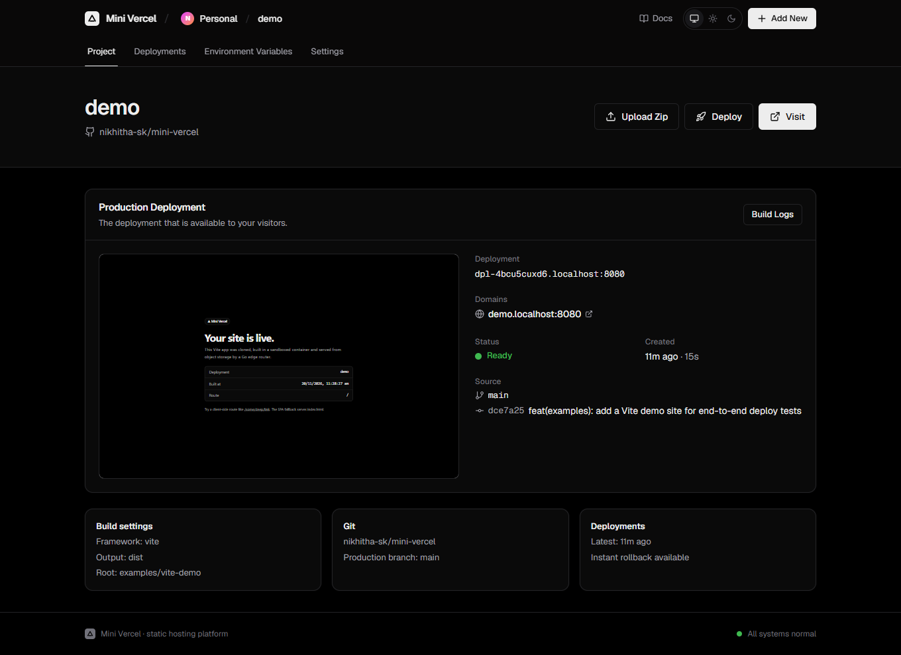

# Mini Vercel

**A self-hosted static hosting platform.** Paste any public GitHub repo (or upload a zip). Mini Vercel auto-detects the framework, builds it inside a sandboxed Docker container and serves it at its own URL, with live build logs, instant rollback and a **free public HTTPS link** you can share with anyone.

> Static sites only (Vite, React, Astro, Next.js static export, plain HTML). Serverless functions and SSR are out of scope on purpose.



| Deployment with live logs | Project (dark mode) |
| --- | --- |
|  |  |

---

## Features

- **Git or zip deploys.** Public HTTPS repo + branch + root directory, or drag-and-drop a `.zip`.
- **Zero-config builds for real projects.** Mini Vercel detects the framework (Vite, Next.js export, Astro, CRA, Angular, SvelteKit, Nuxt, Gatsby, Docusaurus, VitePress, Eleventy, plain HTML, …), the package manager (npm / yarn / pnpm / bun via corepack), the Node version (`.nvmrc` / `engines.node` → 18, 20, 22 or 24) and the output folder. Every value can still be overridden.
- **Free public URLs.** One click on **Go Public** gives a project an `https://<random-words>.trycloudflare.com` link that works from any device, through a Cloudflare quick tunnel. It's free, with no account, domain or port forwarding needed.
- **Sandboxed builds.** Every build gets a fresh `node:<version>-alpine` container: non-root, all capabilities dropped, `no-new-privileges`, 1 vCPU, 2 GB RAM (no swap), 256 PIDs, 10-minute limit. The container is removed afterwards, even on failure. The Docker socket is never mounted into it.
- **Live build logs.** stdout/stderr are streamed over Server-Sent Events (Redis pub/sub) and stored in Postgres for later.
- **Immutable deployments.** Every deployment keeps its own URL forever: `dpl-<id>.localhost:8080`.
- **Production alias + instant rollback.** `<project>.localhost:8080` points at one deployment. Promoting or rolling back is a single `UPSERT` (about 25 ms) with no rebuild.
- **Retries done right.** Infrastructure errors are retried with exponential backoff, while user build errors fail fast. Jobs are idempotent (at-least-once delivery), and a worker killed mid-build is recovered automatically.
- **Edge router.** Host → deployment lookup with an LRU cache invalidated over pub/sub, SPA fallback to `index.html`, custom `404.html`, `immutable` caching for hashed assets, and ETag / 304 for HTML.
- **Encrypted env vars.** AES-256-GCM, bound to the project, decrypted only for the build container.
- **GitHub push webhooks.** HMAC-verified, so each push to the production branch deploys.
- **Professional dashboard.** Next.js static export + Tailwind, light/dark mode, responsive, served by the API itself.

## Architecture

```
            REST / SSE                   jobs                    jobs
Dashboard ─────────────▶ API server ───────────▶ Redis (asynq) ─────────▶ Build workers
(Next.js)               (Go, chi)  ◀─── logs ───  + pub/sub   ◀── logs ──  (Go)
                            │                                                │ Docker API
                            ▼ SQL                                            ▼
                        PostgreSQL ◀──────── status ───────────────── Build container
                            ▲                                          (one per deploy)
                            │ host lookup (cached)                           │ upload dist/
Visitors ── HTTPS ──▶ Edge router (Go) ───── GET ────▶ Object storage ◀──────┘
*.yourdomain        (behind Caddy TLS)              (SeaweedFS / R2: /<deployId>/…)
```

The API never builds anything; workers do. The edge only reads. Each part scales on its own.

| Layer | Choice |
| --- | --- |
| Dashboard | Next.js 15 (static export), Tailwind CSS v4, lucide icons |
| API | Go, chi, pgx v5 |
| Queue | Redis + hibiken/asynq (retries, backoff, timeouts, task dedupe) |
| Sandbox | Docker Engine API (Go SDK), `node:{18,20,22,24}-alpine` |
| Public URLs | Cloudflare quick tunnels (one `cloudflared` container per shared project) |
| Storage | S3 API via aws-sdk-go-v2: SeaweedFS locally, Cloudflare R2 in production |
| Edge | Go `net/http` + LRU cache, Caddy for wildcard TLS |
| Database | PostgreSQL 16 |

### Repository layout

```
cmd/api, cmd/worker, cmd/edge   service entrypoints
internal/api                    REST handlers, SSE log stream, webhooks
internal/worker                 build job handler (clone → install → build → upload → promote)
internal/builder                Docker sandbox, git clone, zip extraction, presets
internal/edge                   host-based router serving files from storage
internal/store                  Postgres schema, migrations, queries
internal/storage, queue, logstream, secrets, config, ids
dashboard/                      Next.js dashboard (static export)
examples/                       test projects + ready-made zips
deploy/                         Dockerfile, Caddyfile, SeaweedFS config
```

---

## Run it locally

### Requirements

- **Docker Desktop** (on Windows, use the WSL2 backend)
- **Go 1.25+**, **Node.js 20+**, **Git**

### Option A: one click (Windows)

Double-click **`run.bat`** in the project folder. This local launcher is git-ignored. It will:

1. start Docker Desktop if it isn't running, and wait for it
2. start Postgres, Redis and S3 storage (`docker compose up -d`)
3. build the Go services and, on first run, the dashboard
4. start the **API**, **Build Worker** and **Edge Router** in the background, with no extra windows; their output goes to `logs\api.log`, `logs\worker.log` and `logs\edge.log`
5. open the dashboard at **http://localhost:4000** and close its own window

Stop everything with `run.bat stop`.

### Option B: manual (any OS)

```bash
# 1. infrastructure
docker compose up -d

# 2. dashboard (once)
cd dashboard && npm ci && npm run build && cd ..

# 3. services: three terminals
MV_DASHBOARD_DIR=dashboard/out go run ./cmd/api     # http://localhost:4000
go run ./cmd/worker
go run ./cmd/edge                                     # http://*.localhost:8080
```

To work on the UI with hot reload, run `npm run dev` in `dashboard/` (http://localhost:3000). It talks to the API on port 4000.

| URL | What |
| --- | --- |
| http://localhost:4000 | Dashboard + API (`/api/...`) |
| http://&lt;project&gt;.localhost:8080 | Production URL of a project |
| http://dpl-&lt;id&gt;.localhost:8080 | Permanent preview URL of one deployment |

> `*.localhost` resolves to your own machine in Chrome, Edge and Firefox, so no DNS setup is needed.

---

## How to test it

The repo ships with test projects in [`examples/`](examples), so you don't need your own site.

| Example | What it tests |
| --- | --- |
| `examples/vite-demo` | A real npm install + Vite build, SPA fallback |
| `examples/static-site` | Plain HTML with no build step, a nested `/about` page, a custom `404.html` |
| `examples/broken-build` | A build that always fails, to show error handling |
| `examples/zips/*.zip` | The same three projects as ready-to-upload zip files |

### Test 1: deploy from GitHub

1. Open http://localhost:4000 → **Add New Project**.
2. Click the **"Vite demo (this repo)"** example chip. It fills in
   repo `https://github.com/nikhitha-sk/mini-vercel`, root directory `examples/vite-demo`, preset **Vite**.
3. Click **Deploy**. You'll see the live build logs stream in (clone → install → build → upload).
4. After about 15–30 s the status turns **Ready**. Click **Visit**, and the site opens at `http://vite-demo.localhost:8080`.

### Test 2: upload a zip

1. **Add New Project** → **Upload Zip**.
2. Drop any zip from `examples/zips/` (`static-site.zip` or `vite-demo.zip`). Leave the framework on **Auto-detect**.
3. Deploy, then visit the site. For `static-site`, also try `/about` and a missing page like `/nope.png` (you should get the custom 404).

### Test 2b: share it on the internet (free)

1. Open a project that has a **Ready** deployment.
2. Click **Go Public** on the *Public URL* card. After about 10 seconds you get a link like `https://some-random-words.trycloudflare.com`.
3. Open that link on your phone (mobile data, not Wi-Fi) or send it to a friend. It works anywhere.
4. Roll back or redeploy, and the public link updates instantly. **Stop sharing** turns it off.

> The public link works while your PC is on and Mini Vercel is running. If Docker restarts, the project gets a new random link (shown in the dashboard). For a permanent address like `portfolio.yourname.dev`, see [Going further](#going-further-permanent-urls).

### Test 2c: deploy a real project from GitHub

Paste any **public** repository URL into **Add New Project**. Leave everything on auto-detect and click **Deploy**. These real repos were deployed successfully during testing:

| Repository | Detected |
| --- | --- |
| `https://github.com/MaeWolff/astro-portfolio-template` | Astro · npm · Node 20 (repo asks for 18) |
| `https://github.com/cobiwave/simplefolio` | Parcel · npm |
| `https://github.com/codewithsadee/vcard-personal-portfolio` | Plain HTML, no build |
| `https://github.com/adrianhajdin/project_3D_developer_portfolio` | Vite + React + Three.js (peer-dep conflict auto-fixed) |
| `https://github.com/soumyajit4419/Portfolio` | Create React App · npm |
| `https://github.com/ronald-hove/Angular-Portfolio-Template` | Angular (webpack-4 era, auto-fixed) |
| `https://github.com/LayZeeDK/github-pages-docusaurus` | Docusaurus · yarn |
| `https://github.com/riipandi/vite-react-template` | Vite + React · pnpm 10 · Node 24 |
| `https://github.com/codeschool-projects/HTMLPortfolioProject` (branch `master`) | Plain HTML kept in `src/` |

**Which projects work?** Anything that builds to static files: React/Vue/Svelte with Vite, Create React App, Angular, Astro, Docusaurus, Gatsby, Eleventy, VitePress, SvelteKit with `adapter-static`, Next.js with `output: 'export'`, Nuxt `generate`, and plain HTML/CSS/JS.
**What doesn't:** private repositories (not yet), and apps that need a running server, such as Next.js SSR/API routes, Express or PHP. Mini Vercel is a *static* hosting platform. If a site needs API keys at build time, add them under **Environment Variables**.

### Test 3: instant rollback

1. On a ready project, click **Deploy** again (or **⋯ → Redeploy**) to create a second deployment.
2. Go to **Deployments**, open the **⋯** menu on the older one → **Promote / Instant Rollback**.
3. The production URL switches immediately. Each deployment's own `dpl-…` URL keeps working.

### Test 4: failed build

Deploy `examples/broken-build` (Git, root directory `examples/broken-build`, preset Vite) or upload `examples/zips/broken-build.zip`.
The deployment ends in **Error**, stderr is shown in red, nothing is served, and it is **not** retried.

### Test 5: env vars, cancel, resilience

- **Environment Variables** tab: add a variable and redeploy. The logs show "Injected 1 environment variable(s)".
- Start a deploy and click **Cancel** while it's building.
- Kill `mv-worker.exe` in Task Manager mid-build and run `run.bat` again. The job is re-delivered and finishes (attempt 2).

### API / command line

```bash
# create a project and deploy it
curl -X POST localhost:4000/api/projects -H "content-type: application/json" \
  -d '{"repoUrl":"https://github.com/nikhitha-sk/mini-vercel","rootDirectory":"examples/vite-demo","framework":"vite","deploy":true}'

# deploy a zip to an existing project
curl -F "file=@examples/zips/static-site.zip" localhost:4000/api/projects/<projectId>/deployments

# stream live logs (SSE)
curl -N localhost:4000/api/deployments/<deploymentId>/events

# roll back
curl -X POST localhost:4000/api/deployments/<deploymentId>/promote
```

### Automated tests

```bash
go test ./...                        # unit tests
cd dashboard && npx tsc --noEmit     # dashboard type-check
```

### Troubleshooting

| Problem | Fix |
| --- | --- |
| "API offline" banner | The API isn't running. Run `run.bat` again, or check `logs/api.log`. |
| Deploy stuck in **Queued** | The Build Worker isn't running or Docker Desktop is stopped. Check `logs/worker.log`. |
| `npm install` fails in the build | The build container needs internet access to reach the npm registry. |
| Site URL doesn't open | Use Chrome/Edge/Firefox. `*.localhost` must resolve to 127.0.0.1. |
| Port already in use | Postgres uses 5433, Redis 6380, S3 9000, API 4000, edge 8080. |
| "Could not find the build output" | Set **Output Directory** in project Settings to the folder your build creates. |
| Next.js "no static export" error | Add `output: 'export'` to `next.config.js`. Server features can't be hosted statically. |
| Go Public stays on "Creating…" | It needs internet access to Cloudflare. It retries every 10 seconds; check `logs/worker.log`. |
| Big project fails with exit 137 | The build ran out of memory. Raise `MV_BUILD_MEMORY_MB` (default 2048). |

---

## API reference

| Method | Path | Description |
| --- | --- | --- |
| GET | `/api/projects` | List projects |
| POST | `/api/projects` | Create project (`deploy: true` to deploy immediately) |
| GET / PATCH / DELETE | `/api/projects/:id` | Read / update / delete |
| GET / PUT | `/api/projects/:id/env` | List keys / set a variable (`{key, value}`) |
| DELETE | `/api/projects/:id/env/:key` | Remove a variable |
| GET / POST | `/api/projects/:id/deployments` | List / deploy (JSON for Git, multipart `file` for zip) |
| GET | `/api/deployments/:id` | Deployment details |
| GET | `/api/deployments/:id/events` | Live logs + status (SSE) |
| GET | `/api/deployments/:id/logs` | Stored logs |
| POST | `/api/deployments/:id/promote` | Point production at this deployment (rollback) |
| POST | `/api/deployments/:id/redeploy` | Rebuild with the same source |
| POST | `/api/deployments/:id/cancel` | Cancel a queued/building deployment |
| POST | `/api/webhooks/github/:projectId` | GitHub push webhook (HMAC `X-Hub-Signature-256`) |

Set `MV_API_TOKEN` to require `Authorization: Bearer <token>`. All settings are listed in [`.env.example`](.env.example).

---

## Build plan & status

| Phase | Goal | Status |
| --- | --- | --- |
| 1 | API + Postgres + worker that builds a public Vite repo | ✅ Done |
| 2 | Docker sandbox, asynq queue, retries, status states, live SSE logs | ✅ Done (verified: a killed worker's job retries and finishes) |
| 3 | Object storage, edge router, alias promote & rollback | ✅ Done locally · ⏳ wildcard domain + TLS on a VPS (`deploy/Caddyfile`) |
| 4 | Dashboard, GitHub webhook, README | ✅ Done · ⏳ GitHub OAuth login, host the dashboard on the platform itself, public demo + recording |

**Next up:** GitHub OAuth (multi-user), deploy to a VPS with Caddy + Cloudflare R2, deploy the dashboard *through* Mini Vercel itself, build cache keyed by lockfile hash, `deploy.json` redirects, per-deployment analytics at the edge.

## Going further: permanent URLs

The built-in **Go Public** links are free and instant, but they are random and only live while your PC runs Mini Vercel. For URLs that never change and stay up 24/7:

| Option | Cost | Result |
| --- | --- | --- |
| **Oracle Cloud "Always Free" VM + DuckDNS + Caddy** | Free (Oracle asks for a card to verify identity, no charge) | `portfolio.yourname.duckdns.org` with HTTPS, running 24/7 without your PC. DuckDNS subdomains support wildcards. |
| **Your own domain + Cloudflare named tunnel** | Domain only (about $1–10 per year) | `portfolio.yourdomain.dev`, served from your PC through a free Cloudflare Tunnel |

Both use the same code: set `MV_ROOT_DOMAIN`, `MV_PUBLIC_SCHEME=https`, `MV_PUBLIC_PORT=443` and put Caddy in front (see `deploy/Caddyfile`).

## Design notes (interview talking points)

- **Immutable deployments + aliases.** Rollback is a pointer swap, and preview URLs never break because files under `/<deployId>/` are never overwritten.
- **Running untrusted code.** Resource limits, non-root, no capabilities, no Docker socket, hard timeouts. Next steps would be egress limits and gVisor or Firecracker microVMs.
- **At-least-once queues.** The handler only moves non-terminal deployments to BUILDING, so duplicate deliveries are no-ops. Storage keys are deterministic. Only infrastructure errors are retried.
- **Edge caching.** Host lookups are cached in memory and invalidated over Redis pub/sub on promote. Hashed assets get `Cache-Control: immutable`.
- **Why not plain NGINX.** Routes change on every deploy. A Go router reads them from Postgres; NGINX with a generated map file + reload is the alternative.
- **Redis queue vs Postgres `SKIP LOCKED`.** asynq gives retries, backoff, timeouts, dedupe and orphan recovery out of the box. Redis is already needed for log pub/sub.

## License

MIT
